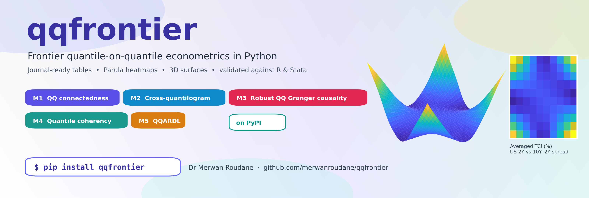
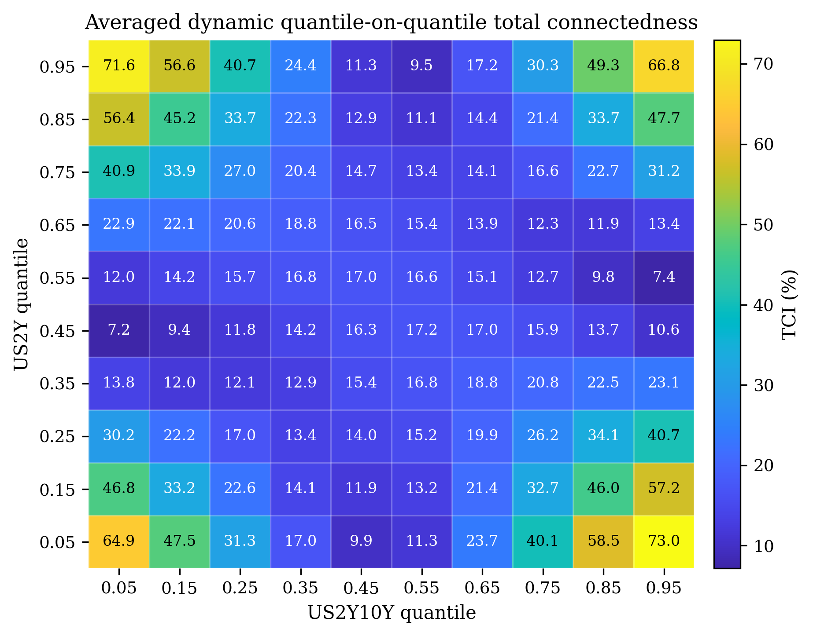
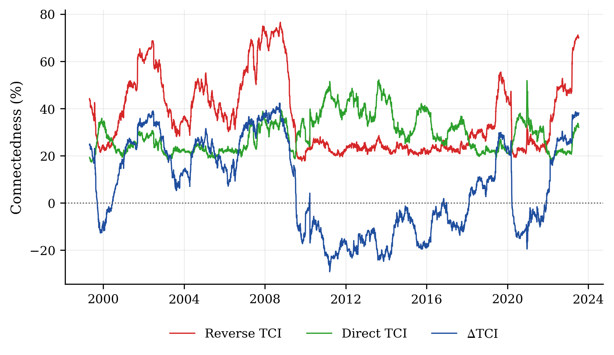
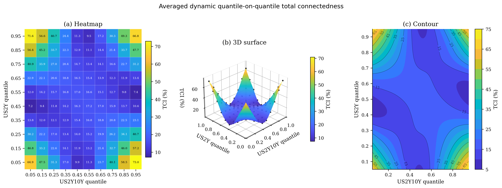
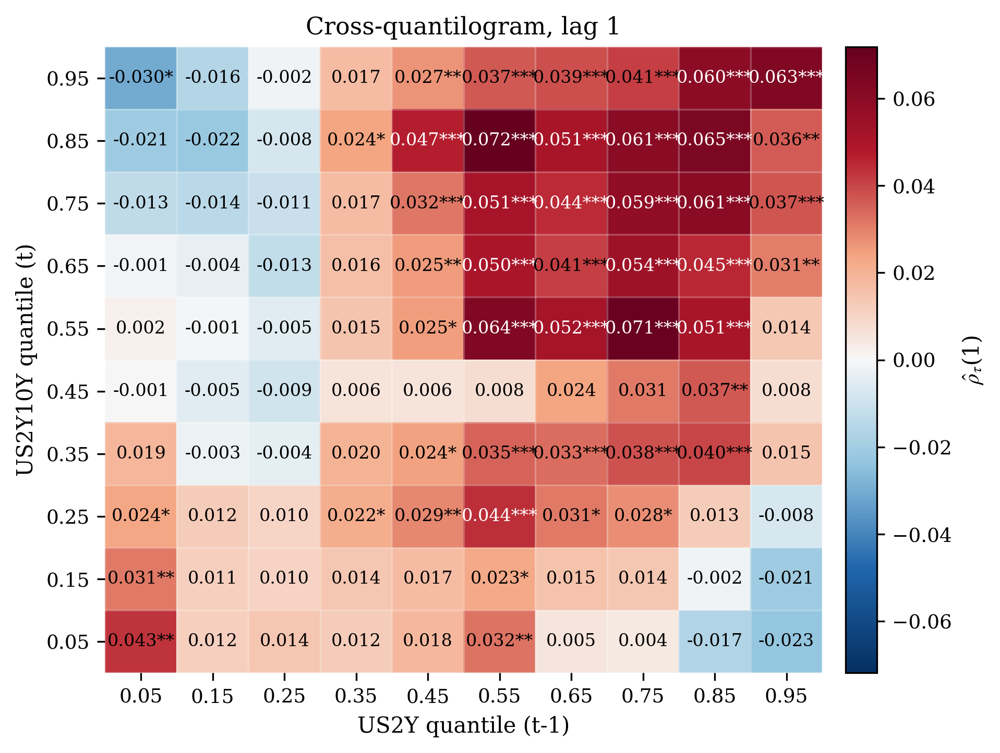
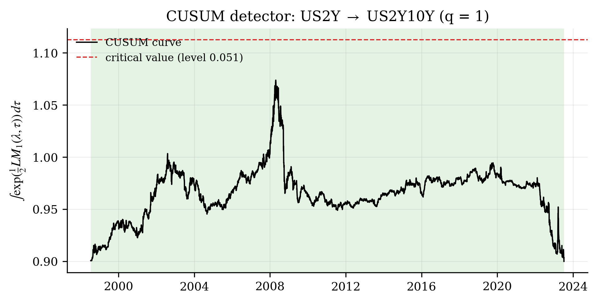
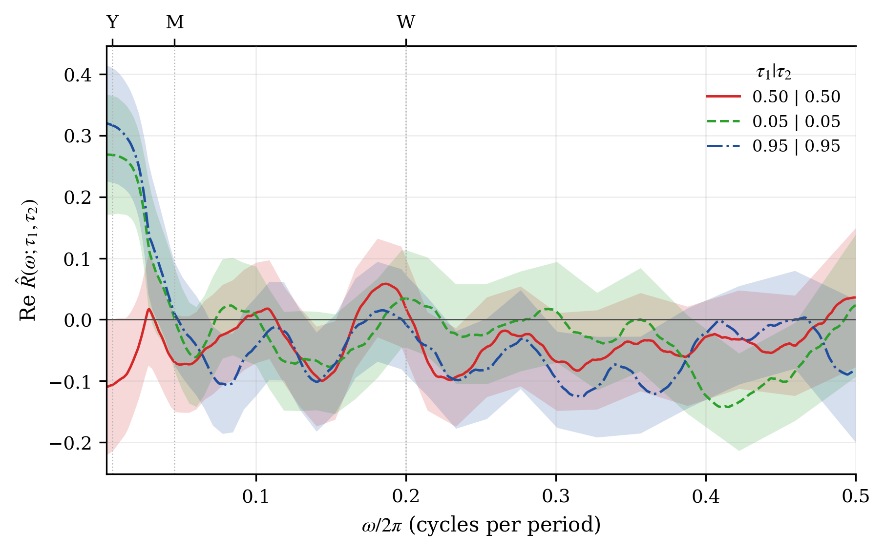
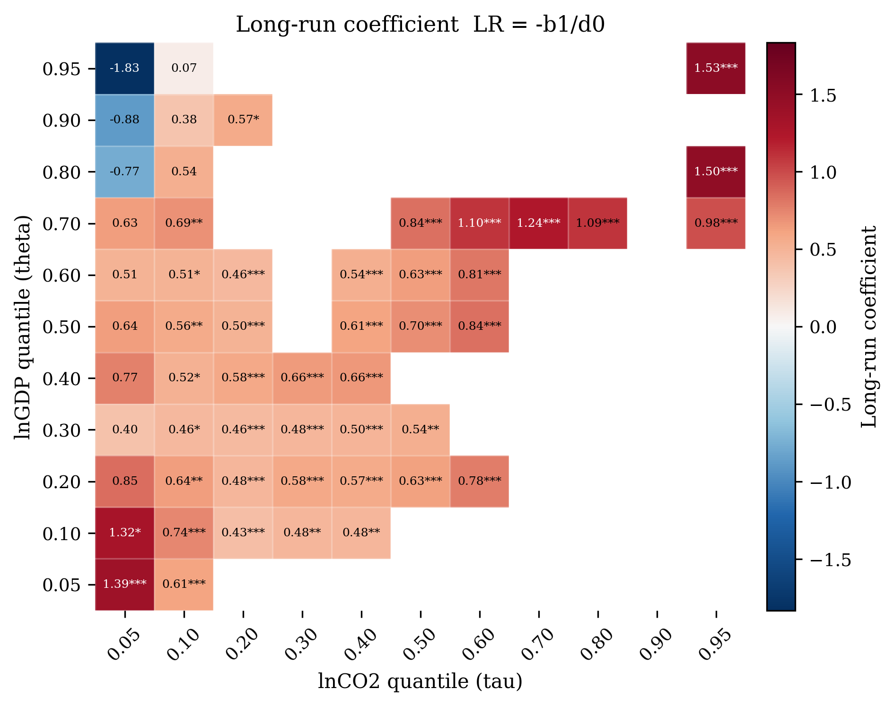
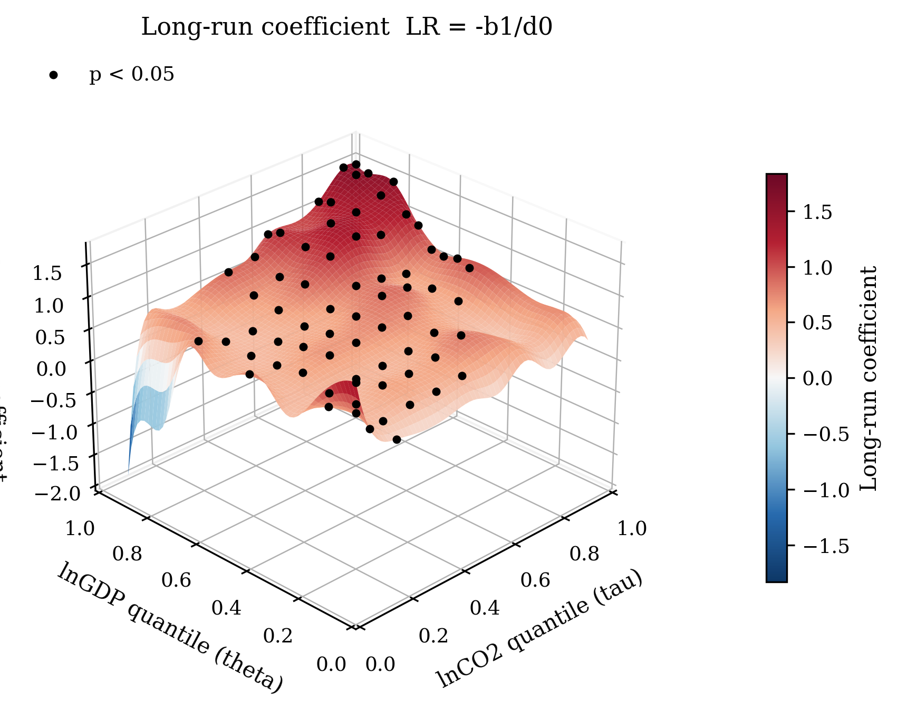

# qqfrontier

<p align="center">
  <a href="https://merwanroudane.github.io/qqfrontier/"></a>
</p>

[](https://pypi.org/project/qqfrontier/)
[](https://pypi.org/project/qqfrontier/)
[](LICENSE)
[](https://merwanroudane.github.io/qqfrontier/)
[](https://github.com/merwanroudane/qqfrontier/actions)

**Frontier quantile-on-quantile econometrics in Python.** Five recent methods in one consistent
interface, with journal-quality tables (text, LaTeX, Markdown), Parula heatmaps, static and
interactive 3D surfaces, and a plain-language interpretation of every result.

| Module | Method | Paper |
|---|---|---|
| **M1** `connectedness` | Quantile-on-quantile connectedness: rolling QVAR, kernel Q-on-Q-QVAR, TVP-QQVAR | Gabauer & Stenfors (2024, *FRL*); Bonaccolto, Caporin & Gupta (2026, *FRL*); Candelo-Viáfara & Orrego-Reyes (2026) |
| **M2** `quantilogram` | Cross-quantilogram, Box–Ljung and sup tests, partial cross-quantilogram | Han, Linton, Oka & Whang (2016, *J. Econometrics*) |
| **M3** `causality` | Quantile Granger causality robust to instability, regime dating | Mayer, Wied & Troster (2025, *J. Econometrics*) |
| **M4** `coherency` | Quantile coherency across frequencies with confidence intervals | Baruník & Kley (2019, *Econometrics Journal*) |
| **M5** `qqardl` | Quantile-on-quantile ARDL: bounds test, long run, short run, ECT | Destek et al. (2025, *J. Environmental Management*) |

📦 **PyPI:** https://pypi.org/project/qqfrontier/0.1.1/ · 📖 **Website:** https://merwanroudane.github.io/qqfrontier/ · 🧭 **Step-by-step guide:** [GUIDE.md](GUIDE.md) · 📐 **Methods:** [docs/methods.md](docs/methods.md)
🧑‍💻 **Author:** Dr Merwan Roudane · merwanroudane920@gmail.com · https://github.com/merwanroudane

---

## Installation

```bash
pip install "qqfrontier[full]"
```

`[full]` adds plotly (interactive 3D), numba (fast quantile regressions), joblib (parallel
computing) and arch (ERS unit-root test). The core needs only numpy, scipy, pandas,
matplotlib and statsmodels. Never used Python? Follow [GUIDE.md](GUIDE.md), Part A.

## Sixty-second tour

```python
import numpy as np
import qqfrontier as qf

yl = qf.load_us_yields(main_only=True)              # FRED: US 2Y yield and 10Y-2Y spread, daily changes
print(qf.descriptive_table(yl[["US2Y", "US2Y10Y"]])) # summary statistics with tests

# M1 - quantile-on-quantile connectedness (Gabauer and Stenfors, 2024)
gs = qf.qqc_gs(yl[["date", "US2Y", "US2Y10Y"]], taus=np.arange(0.05, 1, 0.10), window=200, horizon=20)
print(gs.summary()); print(gs.interpret())
gs.plot("heatmap"); gs.plot("dynamic"); gs.plot("surface")

# M2 - cross-quantilogram
y1, y2 = yl.set_index("date")["US2Y10Y"], yl.set_index("date")["US2Y"]
cq = qf.cross_quantilogram_test(y1, y2, [0.05, 0.5, 0.95], [0.1, 0.9], max_lag=10, n_boot=1000, seed=1)

# M3 - quantile Granger causality robust to instability
gc = qf.qgc_instability(y1, y2, lags=1, n_boot=499, seed=3)

# M4 - quantile coherency
coh = qf.quantile_coherency(yl["US2Y"], yl["US2Y10Y"], periods={"W": 5, "M": 22, "Y": 250})

# M5 - quantile-on-quantile ARDL (World Bank data)
d = qf.load_wdi_co2_gdp("Algeria").set_index("year")
r = qf.qqardl_fit(d["lnCO2"], d["lnGDP"])
print(r.summary())
```

Every result object offers `summary()`, `to_latex()`, `to_markdown()`, `to_frame()`,
`interpret()` and `plot(kind)`; `qf.save_figure(fig, "name")` writes a vector PDF and a
300-dpi PNG.

## Selected outputs (real data, `examples/qqfrontier_empirical.py`)

**M1.** Averaged quantile-on-quantile TCI of the US 2-year yield and the 10Y–2Y spread
(reproduces Fig. 1(a) of Bonaccolto, Caporin and Gupta, 2026, cell by cell), and the
direct / reverse dynamics:

<p align="center">


</p>
<p align="center"></p>

**M2–M4.** Cross-quantilogram with bootstrap bands, CUSUM detector with dated regimes, and
quantile coherency across cycles:

<p align="center">



</p>

**M5.** Long-run effect of GDP on CO₂ in Algeria by quantile pair, heatmap and 3D surface:

<p align="center">


</p>

All tables and figures of the five applications, with code and interpretation, are on the
[website](https://merwanroudane.github.io/qqfrontier/).

## Validation

| Module | Reference implementation | Agreement |
|---|---|---|
| QR engine | R `quantreg` (`fn`, `br`), `qqconnect::rq_noncross` | 1e-7 |
| M1 | R `qqconnect` 0.1.0; Fig. 1(a) of BCG (2026) | averaged grid identical; TVP to 1e-12 |
| M2 | R `quantilogram`, `np::b.star` | 1e-10 |
| M3 | simulated breaks and nulls | break dated within 1% of the sample |
| M4 | Eq. (2.6) by direct evaluation; Monte Carlo coverage | coverage 94–96% |
| M5 | Stata `qqardl` 1.1.0 (Algeria example) | all four 11 × 11 tables, same stars, 53/121 cointegrated pairs |

Run the tests with `pytest -q`.

## Data

* `load_us_yields()` – FRED DGS2 and T10Y2Y daily changes in basis points, 1998–2023 (public domain).
* `load_wdi_co2_gdp()` – World Bank WDI GDP per capita and CO₂ per capita, Algeria and Egypt (CC BY 4.0).

## Citation

```bibtex
@software{roudane2026qqfrontier,
  author  = {Roudane, Merwan},
  title   = {qqfrontier: Frontier Quantile-on-Quantile Econometrics in Python},
  year    = {2026},
  version = {0.1.1},
  url     = {https://github.com/merwanroudane/qqfrontier}
}
```

Please also cite the paper of each method you use (see [docs/methods.md](docs/methods.md)).

## Related packages by the same author

R (CRAN): [QuantileOnQuantile](https://cran.r-project.org/package=QuantileOnQuantile),
[mqqr](https://cran.r-project.org/package=mqqr), [qqkrls](https://cran.r-project.org/package=qqkrls),
[mqqcause](https://cran.r-project.org/package=mqqcause) · Python (PyPI): [wqr](https://pypi.org/project/wqr/),
[mqqr](https://pypi.org/project/mqqr/), [qqkrls](https://pypi.org/project/qqkrls/).

## Author and licence

**Dr Merwan Roudane** · merwanroudane920@gmail.com · https://github.com/merwanroudane
MIT Licence © 2026 Merwan Roudane.
